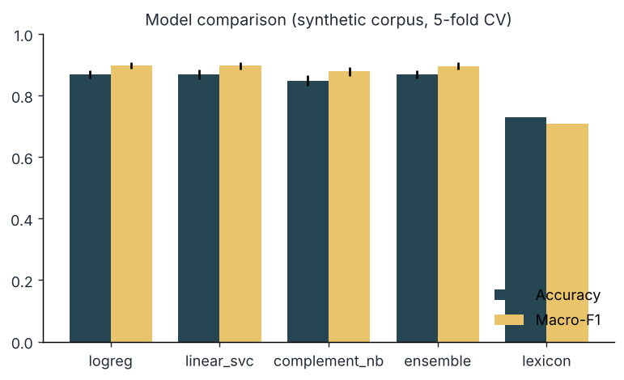
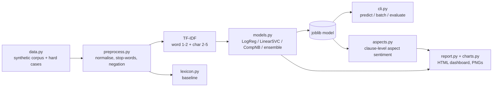
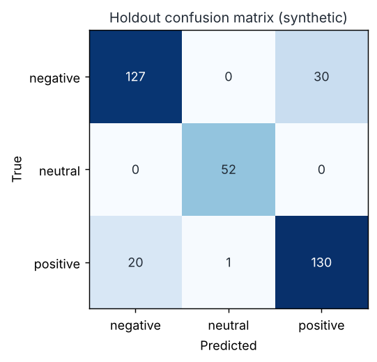
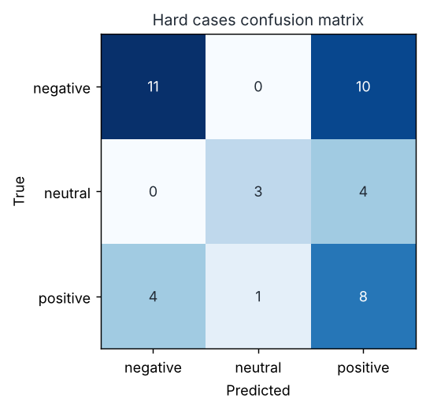
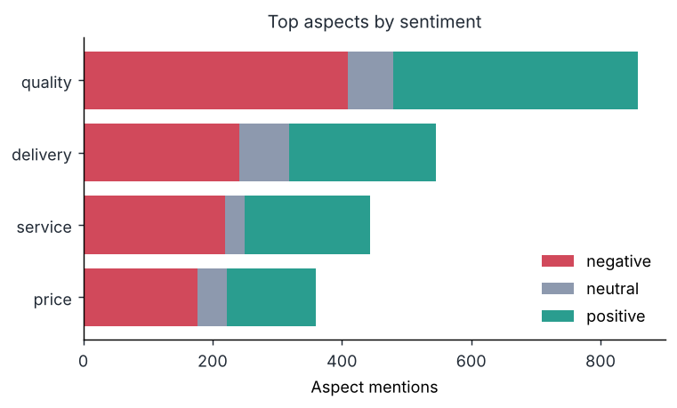
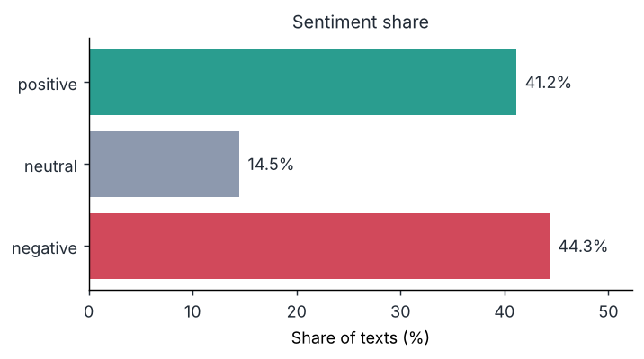
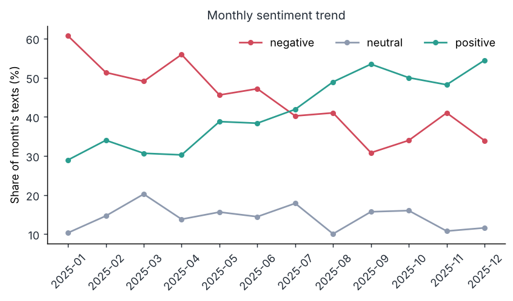

# Arabic Sentiment Analyzer

Arabic sentiment analysis (positive / negative / neutral) with **classical machine learning only**: rule-based Arabic
preprocessing, TF-IDF word + character n-grams, logistic regression, linear SVM, complement naive Bayes, a soft-voting
ensemble and a small hand-written lexicon baseline. Also included: keyword-based aspect extraction
(delivery, price, service, quality), a CLI with joblib persistence, and a self-contained HTML dashboard.
Everything is trained and tested on a **synthetic** corpus generated in this repository.

**ملخص بالعربية:** مشروع لتحليل المشاعر في النصوص العربية (إيجابي / سلبي / محايد) باستخدام تعلّم الآلة الكلاسيكي فقط: معالجة نصوص عربية (إزالة التشكيل والتطويل، توحيد الحروف، تقليص الحروف المكررة، التعامل مع الروابط والإيموجي، كلمات إيقاف فصحى وخليجية، ووسم النفي)، ثم TF-IDF وتصنيفات خطية ومقارنة بالتحقق المتقاطع، مع قاموس مشاعر مكتوب يدويًا كخط أساس. يستخرج المشروع أيضًا الجوانب (التوصيل، السعر، الخدمة، الجودة) ويُنتج لوحة HTML مستقلة. **جميع البيانات اصطناعية** (مولَّدة من قوالب)، لذلك الدقة المعروضة تقدير متفائل ولا تمثل أداءً على نصوص حقيقية.



## Features

- **Preprocessing** (`preprocess.py`): NFKC, URL / e-mail / @mention removal, hashtag words kept, emoji mapped to `emopos` / `emoneg` tokens (others dropped), tashkeel and tatweel removal, letter normalisation (alef variants, ya, ta marbuta ...), repeated-letter squeeze (`جمييييل` to `جميل`), Eastern-Arabic digits to ASCII, MSA + Gulf-aware stop-words, and negation marking: `ما / لا / لم / لن / مو / مب / مش / ليس ...` prefix the next words with `NOT_` (window of 2 content words, closed by punctuation or a contrast word such as `لكن` / `بس`; fixed phrases such as `ما شاء الله` are protected).
- **Models** (`models.py`): TF-IDF word 1-2-grams + char_wb 2-5-grams feeding `LogisticRegression`, `LinearSVC`, `ComplementNB` and a soft-voting `ensemble` (LR + calibrated SVC + NB), compared with stratified 5-fold cross-validation.
- **Lexicon baseline** (`lexicon.py`): 110 hand-written MSA + Gulf polarity words, negation flips the sign, words after a contrast word count double.
- **Data** (`data.py`): 1,800-row **synthetic** corpus (restaurants, delivery, telecom, e-commerce; MSA and Saudi/Gulf flavours; templated with variety, emoji, URLs, elongation) plus 41 **hand-written hard cases** (negation, mixed sentiment, idioms, sarcasm, neutral questions).
- **Aspects** (`aspects.py`): keyword matching for delivery / price / service / quality; sentiment is predicted per *clause*, so one review can be positive on quality and negative on delivery.
- **Dashboard** (`report.py`): one HTML file, inline CSS and base64 PNGs, no scripts: sentiment share, monthly trend, top aspects, top n-grams per class.
- **CLI** (`python -m arabic_sentiment`), logging, type hints, 33 pytest tests.

## Architecture



## Quickstart

```bash
python -m pip install -r requirements.txt   # numpy, pandas, scikit-learn, matplotlib, joblib, pytest
python scripts/demo.py                      # corpus -> CV -> train -> hard cases -> PNGs + dashboard
python -m pytest -q
```

Open `docs/sample_dashboard.html` in a browser (generated by the demo and committed as a sample).

## Usage

```bash
python -m arabic_sentiment generate --n 1800 --out data/synthetic_corpus.csv
python -m arabic_sentiment train --model ensemble            # saves models/sentiment.joblib
python -m arabic_sentiment predict "ما عجبني الخدمة ابدا 😡"
python -m arabic_sentiment batch reviews.csv --column text   # writes reviews_predictions.csv
python -m arabic_sentiment evaluate                          # CV + hard cases + dialect transfer
```

`train` and `evaluate` accept `--data file.csv` (columns `text,label`) to use your own labelled data.

Real output of `predict` with the model trained by the demo (full JSON, nothing trimmed):

```text
$ python -m arabic_sentiment predict "ما عجبني الخدمة ابدا 😡"
{
  "text": "ما عجبني الخدمة ابدا 😡",
  "label": "negative",
  "confidence": 0.994,
  "aspects": {
    "service": {
      "negative": 1,
      "neutral": 0,
      "positive": 0
    }
  }
}
```

A second run, `predict "الأكل لذيذ لكن التوصيل متأخر والسعر غالي"`, returned `label: positive` with `confidence: 0.591`, and per-aspect counts of quality 1 positive, delivery 1 negative, price 1 negative. This illustrates a limit: the aspect clauses are read correctly, but the whole-sentence label is only weakly positive.

## Results (synthetic corpus: read the caveats)

Output of `python scripts/demo.py` (seed 42, 1,800 synthetic rows: 782 negative, 757 positive, 261 neutral):

```text
5-fold CV (synthetic, optimistic):
        model  accuracy_mean  accuracy_std  macro_f1_mean  macro_f1_std
       logreg          0.869         0.014          0.897         0.011
   linear_svc          0.869         0.015          0.897         0.013
complement_nb          0.848         0.017          0.879         0.014
     ensemble          0.869         0.013          0.896         0.011
      lexicon          0.728           NaN          0.710           NaN

Ensemble holdout (360 rows): accuracy=0.858 macro-F1=0.887
              negative   neutral  positive
negative           127         0        30
neutral              0        52         0
positive           20         1       130
  holdout with contrast word: n=42 accuracy=0.500
  holdout without contrast word: n=318 accuracy=0.906

Hard cases (41 hand-written sentences, logreg trained on synthetic corpus): accuracy=0.537 macro-F1=0.538
              negative   neutral  positive
negative           11         0        10
neutral             0         3         4
positive            4         1         8
accuracy by kind: {'idiom': 0.67, 'mixed': 0.29, 'negation': 0.67, 'neutral': 0.6, 'plain': 0.62, 'sarcasm': 0.0}
dialect transfer (logreg): {'msa->gulf': 0.758, 'gulf->msa': 0.787}
```

How to read this:

- The three trained models are within about two points of each other, which on a corpus this templated is within noise. The ensemble is **not** shown to be better.
- The lexicon baseline (scored on all 1,800 rows, no training) reaches 0.728 accuracy; the learned models add roughly 14 points.
- Most holdout errors come from **mixed-sentiment** texts ("X is great, *but* Y is bad", labelled by the clause after the contrast word): 0.50 accuracy with a contrast word vs 0.906 without. TF-IDF n-grams ignore clause order, so they cannot reliably tell which side wins.
- The **hand-written hard cases** drop to 0.537 accuracy, with sarcasm at 0/3 and mixed sentiment at 2/7. That gap is the honest picture; the 0.87 figure above is an optimistic upper bound because the corpus is built from a small vocabulary and near-duplicate sentences land in different CV folds. Swapping dialects (train on MSA, test on Gulf, and back) gives 0.76 to 0.79.
- The model also learns generator artefacts. For example, "السعر غالي جدا" ("the price is very high") is predicted positive because "جدا" co-occurs with positive text in the synthetic data, while "السعر غالي" is predicted negative.

| Holdout confusion matrix | Hard-case confusion matrix |
|---|---|
|  |  |

### Aspects, share and trend (predicted on the synthetic corpus)

Aspect mentions (predicted clause sentiment): quality 858 (409 negative / 71 neutral / 378 positive), delivery 546, service 444, price 360.

| Top aspects | Sentiment share |
|---|---|
|  |  |



The upward positive trend is **built into the generator** (P(positive) rises from 0.35 to 0.65 across the 12 months); the chart shows the dashboard works, not a real trend. Chart labels are English because `arabic_reshaper` / `python-bidi` are not available and matplotlib alone renders Arabic incorrectly; Arabic n-grams appear in the HTML dashboard, where the browser shapes them.

## Project structure

```text
arabic_sentiment/  config, preprocess, data, lexicon, models, aspects, charts, report, cli, logging_utils
scripts/           demo.py
tests/             33 pytest tests (preprocess, models, aspects, CLI, dashboard)
docs/              generated PNG charts, sample_dashboard.html, sample_corpus.csv (synthetic)
.github/workflows/ ci.yml (pytest on Python 3.11 - 3.13)
```

## Testing

```bash
python -m pytest -q      # 33 passed
```

Tests cover each preprocessing step (tashkeel, tatweel, letter normalisation, elongation, URLs, emoji, digits, stop-words, negation scope and protected phrases), corpus determinism, lexicon polarity and negation flip, all four models, confusion-matrix consistency, a check that hard cases score below the synthetic holdout, joblib round-trip, aspect extraction and clause splitting, PNG output, dashboard self-containment and the CLI commands.

## Limitations

- **All training and evaluation text is synthetic** (templates plus hand-written lists). No real reviews or social-media posts were used, so reported accuracy says little about real-world performance; expect much lower.
- The 41 hard cases are few and hand-labelled by the author; some labels are debatable. Treat the 0.537 as a rough indication, not a benchmark.
- Bag-of-n-grams models cannot handle sarcasm, long-range negation or mixed sentiment well (shown above).
- Dialect coverage is limited to MSA and a Saudi/Gulf flavour; no Egyptian, Levantine or Maghrebi, and no Arabizi (Latin-script Arabic).
- The lexicon (110 words) and stop-word list are small and hand-written, not validated against any published resource.
- Aspect extraction is keyword matching; it misses unlisted words and clause-level sentiment can be wrong for short clauses.
- The dashboard predictions in the sample include rows the saved model was trained on.
- No transformer or Arabic-specific tools (e.g. CAMeL Tools, AraBERT) were used or compared.

## Roadmap

- Evaluate on a real, licensed Arabic sentiment dataset and report the gap.
- Clause-aware features for contrast words and negation.
- Compare against a pre-trained Arabic transformer.
- More dialects and a larger, hand-labelled hard-case set.

## Built with AI assistance

This project was built with the help of an AI assistant (Claude). The code, tests, synthetic data templates and README were drafted with AI help; the numbers above are pasted from real runs of the code in this repository. Review it before relying on it.

## License

MIT, see [LICENSE](LICENSE).
